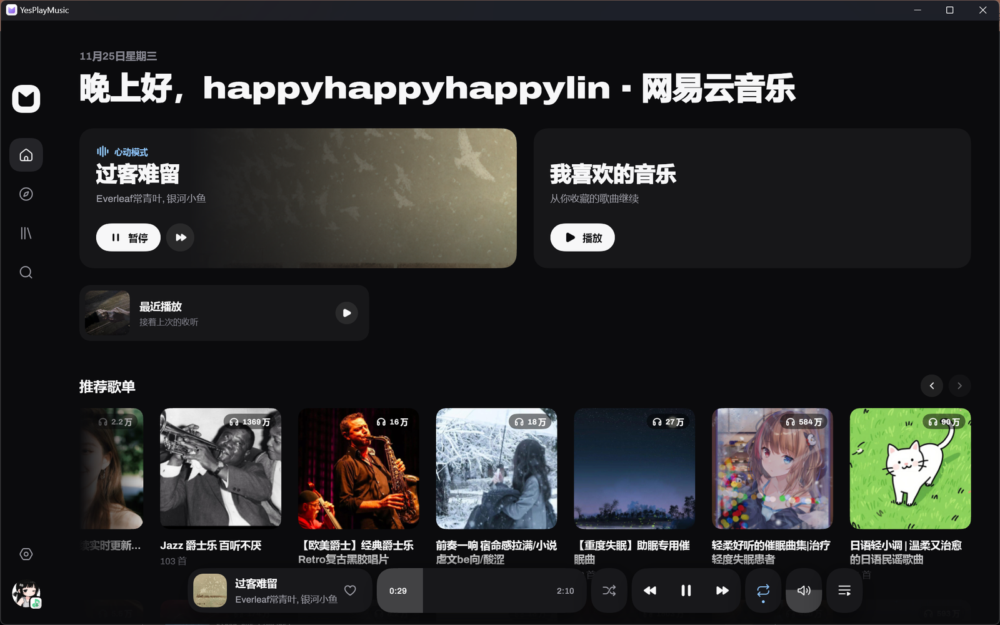
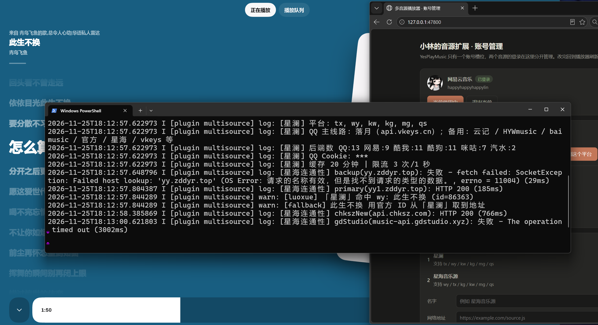

# 小林的音源扩展

YesPlayMusic 3.0 插件。把网易云音乐和 QQ 音乐合成一个入口，共用一套搜索、歌单和播放；官方拿不到音频时，交给洛雪音源（lx-music）取址。

- **一个入口，两个平台**：搜索合并两个平台的结果，当前账号所属平台排前面
- **多账号**：同一平台可登录多个账号，随时切换，互不覆盖
- **洛雪音源**：导入 lx-music 格式的 `.js` 音源，官方放不了的歌交给它取址
- **控制台**：`http://127.0.0.1:47800` 管理账号、音源、音质

需要 YesPlayMusic 3.0.0 或更高。

Web 管理控制台需要 **Node.js 18+**（[下载](https://nodejs.org/)）。没装 Node 时插件本身照常工作，只是控制台起不来，账号管理和音源导入用不了。

可用洛雪音源仓库：[pdone/lx-music-source](https://github.com/pdone/lx-music-source)



首页：心动模式接着当前歌推荐，「我喜欢的音乐」「最近播放」并排，下面接推荐歌单。



播放器、管理控制台与回落日志同屏：官方灰歌时由落雪音源取址，日志可见命中过程。

## 安装

**从 GitHub 安装**：设置 → 插件 → 安装插件，粘贴 `github.com/Linmord/ypm-plugin-lingaiyuelx`。

**从本地安装**：下载 Release 里的 zip 解压，设置 → 插件 →「从本地文件夹安装…」选解压后的目录。

安装后到「设置 → 插件 → 音乐来源」选中它。

## 登录

两个平台各用各的账号体系，登录方式也不同。

### 网易云音乐

扫码登录。在控制台点「登录」，用网易云 App 扫码。

### QQ 音乐

三种方式，在控制台 QQ 音乐那一行直接选：

| 方式 | 说明 |
| --- | --- |
| 微信扫码 | 走微信开放平台，微信账号用这个 |
| QQ 扫码 | 走 QQ 互联，QQ 号账号用这个 |
| 手动 Cookie | 浏览器登录 y.qq.com 后复制 `qqmusic_key` 和 `qqmusic_uin` |

> QQ 音乐手机 App 扫码已移除：微信账号在 App 扫码路径上换不到凭据。

## 多账号

同一个平台可以登录多个账号。控制台「已保存的账号」里每个账号都能单独切换或删除。

宿主的插件设置面板只有一个账号槽位，所以账号管理放在控制台：

```
http://127.0.0.1:47800
```

启动方式：**插件加载时会自动拉起**，宿主退出时跟着退出。也可以手动运行 `console/启动管理控制台.bat`（Windows）或 `console/启动管理控制台.sh`（macOS / Linux）。

## 洛雪音源

官方接口拿不到音频时（要会员、地区无版权），插件会用你导入的洛雪音源取址。

**导入**：控制台「落雪音源导入」，填名字 + 网络地址或选本地 `.js` 文件。

**顺序**：拖动排序，序号 1 的最先被尝试。

**取址顺序**：

1. 用当前平台的官方歌曲 ID 直接问洛雪音源（最准，不会搜错版本）
2. 失败则按歌名 + 时长去其他平台搜同版本

没有导入任何音源时，官方放不了的歌就放不了，插件不会拿别的版本顶替。

## 控制台

```
http://127.0.0.1:47800
```

**需要 Node.js 18 或更高版本**（[下载](https://nodejs.org/)）。

控制台是个本地网页服务，靠 Node 跑插件自己的登录与音源逻辑。没装 Node 的话：

- **插件本身照常工作**（搜索、播放、歌单都不受影响）
- 只是控制台起不来，账号管理和音源导入用不了

**启动方式**：插件加载时自动启动，宿主退出时跟着退出。也可以手动运行 `console/启动管理控制台.bat`（Windows）或 `console/启动管理控制台.sh`（macOS / Linux）。

只监听 `127.0.0.1`，不对外网开放，也没有鉴权——用完请关掉。

## 开发

```sh
node --experimental-vm-modules test/host.test.mjs   # 模块图、命名空间、存储隔离
node --experimental-vm-modules test/e2e.test.mjs    # 搜索合并、回落、源分派
node --experimental-vm-modules test/merge.test.mjs  # 两源都成功时的合并
node --experimental-vm-modules test/accounts.test.mjs
node --experimental-vm-modules test/signout.test.mjs
```

打包：`python3 package.py`，产物在 `dist/`。

插件接口见 [YesPlayMusic 插件开发指南](https://github.com/qier222/YesPlayMusic/blob/main/docs/plugins.md)。

## 目录

```
plugin.json              插件清单
index.js                 入口：聚合两个音源、搜索合并、播放回落
providers/netease/       网易云：eapi 加密、登录、曲库、播放
providers/qq/            QQ 音乐：签名、三种登录、曲库、播放
  wxlogin.js             微信开放平台扫码
  qqlogin.js             QQ 互联扫码
  login.js               登录编排 + 多账号
shared/
  ids.js                 「音源:原始id」命名空间
  storage.js             按音源隔离的 storage
  accounts.js            多账号表
  luoxue.js              洛雪音源运行时（eval 隔离）
  searchid.js            按歌名搜各平台 ID
  policy.js              「灰歌是否可播」由回落开关决定
locales/                 9 种语言
```

## 第三方

业务逻辑基于两个 MIT 协议的社区插件，在此基础上增加了多音源聚合、多账号、洛雪音源接入：

- [lymzzyh/ypm-plugin-netease](https://github.com/lymzzyh/ypm-plugin-netease) — 见 `LICENSE-NETEASE`
- [lymzzyh/ypm-plugin-qqmusic](https://github.com/lymzzyh/ypm-plugin-qqmusic) — 见 `LICENSE-QQMUSIC`

图标来自 [lyswhut/lx-music-desktop](https://github.com/lyswhut/lx-music-desktop)（MIT），见 `THIRD_PARTY_MIT_LICENSE`。

## 免责声明

本插件不提供、不分发任何音频内容，只在你已登录的账号权限范围内取址。请遵守各平台的服务条款，不要用于商业用途。
