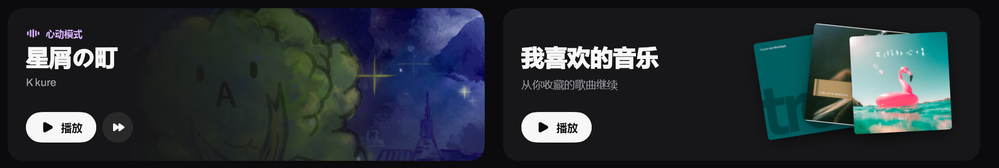

## 首页卡片动态封面

「我喜欢的音乐」封面不再是一张静态图——现在传前三首收藏的歌，宿主大卡用它们的专辑封面做层叠效果。**收藏新歌后首页封面跟着变**。

## 修复

- 歌单详情 `coverImgUrl` 的 CDN 路径会 404，改用歌曲专辑封面

## 上游同步

上游 `lymzzyh/ypm-plugin-netease` 近期合入了心动模式等改进（本插件已同步实现）；`ypm-plugin-qqmusic` 加入了音质选择与购买专辑权限修复（本插件音质设置已覆盖）。

## 其他

- README 补充 Node.js 18+ 要求、可用洛雪音源仓库 [pdone/lx-music-source](https://github.com/pdone/lx-music-source)
- 发布包含完整 `console/` 与 `docs/`

## 功能

- **一个入口，两个平台**：网易云音乐与 QQ 音乐共用搜索、歌单、播放
- **多账号**：同一平台可登录多个账号，随时切换
- **洛雪音源**：导入 lx-music 格式音源，官方放不了的歌交给它取址
- **控制台**：`http://127.0.0.1:47800`，随插件启停，需要 Node.js 18+

## 安装

1. 下载 `YesPlayMusic-multisource-0.2.3.zip` 解压
2. 设置 → 插件 → 「从本地文件夹安装…」，选解压后的目录
3. 设置 → 插件 → 音乐来源，选中「小林的音源扩展」

首次启动如果控制台没起来，去插件 ⋯ 菜单勾选「允许运行本机程序」。

## 说明

本插件不提供、不分发任何音频内容，只在你已登录的账号权限范围内取址。请遵守各平台服务条款。
